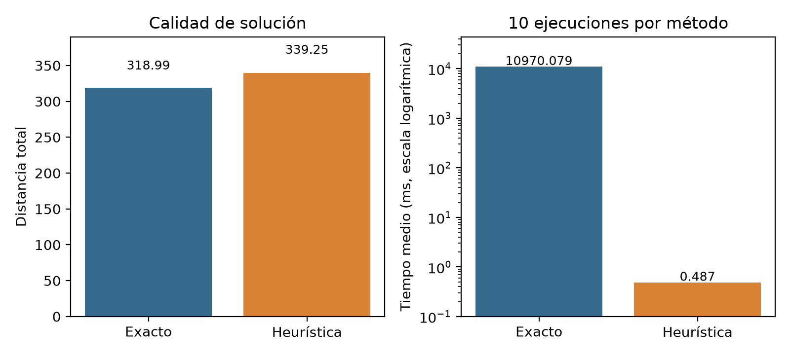

# CVRP de logística urbana: solución exacta frente a heurística

Ruteo de vehículos con capacidad limitada (**CVRP**) para una instancia didáctica de **10 clientes y un depósito**. El repositorio resuelve el caso con un **modelo exacto de arcos binarios y carga física** (PuLP + CBC), lo contrasta con la heurística de **ahorros de Clarke–Wright + 2-opt** y reúne datos, resultados, figuras, código de verificación y el informe vigente.

Proyecto del curso *Diseño de algoritmos matemáticos bioinspirados*, Etapa 1. Una sola instancia: los resultados ilustran el método, no demuestran superioridad general.


## Resultado en breve

| | Exacto (arcos y carga) | Heurística (C–W + 2-opt) |
|---|---:|---:|
| Distancia total (unidades) | **318.9895** | 339.2529 |
| Rutas | 4 | 4 |
| Garantía | óptimo probado | solución factible, sin garantía |
| Tiempo medio, 10 ejecuciones | 10.970 s | 0.487 ms |
| **GAP de costo** | 0 % | **6.352 %** |

**¿Qué es el GAP?** Cuánto más larga es la ruta de la heurística que la óptima:
`GAP = 100 · (339.2529 − 318.9895) / 318.9895 ≈ 6.35 %` (20.26 unidades de distancia más). No es una cota del solver ni se mezcla con la diferencia de tiempos.

> **Tiempos:** son mediciones históricas de un equipo concreto (Windows 11, Python 3.12.14, PuLP 3.3.0, CBC serial). Una reejecución propia dio **5.421 s**, con idénticas distancias; véase [`docs/coherencia.md`](docs/coherencia.md). Los tiempos no se comparan con los del [modelo anterior](archive/v1_modelo_particion_rutas/README.md).

**Datos de la instancia:** capacidad por vehículo `Q = 50`; demanda total 146 → al menos `⌈146/50⌉ = 3` rutas. Distancia euclidiana **sin redondeo** (con distancias enteras tipo EUC_2D el óptimo es 317). El archivo no indica unidades físicas.

## El problema

Una flota homogénea sale de un depósito, entrega a cada cliente una sola vez sin superar la capacidad y regresa. Se minimiza la distancia recorrida; el número de rutas lo decide el modelo. Con tres rutas se puede atender a todos (carga libre global 2.7 %), pero recorren **20.18 unidades más** que las cuatro rutas óptimas: minimizar distancia y minimizar vehículos son objetivos distintos.

## Método exacto frente a heurística

| | Modelo exacto | Clarke–Wright + 2-opt |
|---|---|---|
| Idea | Elige arcos `xᵢⱼ` y la carga que viaja por cada uno `fᵢⱼ`; CBC prueba el óptimo | Fusiona rutas por mayor ahorro `cᵢ₁ + cⱼ₁ − cᵢⱼ` y pule cada ruta con 2-opt |
| Restricciones | visita, continuidad, balance en depósito, balance de producto, capacidad por arco, 1 013 subrutas prohibidas | capacidad al fusionar |
| Tamaño del modelo | 220 variables · 1 167 restricciones | — |
| Escala | enumerar las subrutas solo es viable con pocos clientes | rápida, sin garantía |


Ecuaciones completas, supuestos y protocolo de medición: [`docs/metodologia.md`](docs/metodologia.md).

## Rutas

**Óptima (exacta), 318.9895:**

| Ruta | Clientes | Carga / 50 | Distancia |
|---|---|---:|---:|
| 1 | 1 → 3 → 2 → 6 → 1 | 44 | 101.19 |
| 2 | 1 → 4 → 5 → 11 → 1 | 42 | 86.18 |
| 3 | 1 → 7 → 8 → 9 → 1 | 47 | 109.26 |
| 4 | 1 → 10 → 1 | 13 | 22.36 |

**Heurística, 339.2529:** [`figures/rutas_heuristica.png`](figures/rutas_heuristica.png) (cargas 17, 44, 36 y 49).
**Flota mínima, 3 rutas, 339.1647:** [`figures/rutas_tres.png`](figures/rutas_tres.png) (cargas 47, 50 y 49). Este valor está certificado por enumeración de particiones; el modelo de arcos no lo prueba en 120 s ([detalle](docs/coherencia.md#2-contradicción-encontrada-escenario-de-tres-rutas)).



## Informe vigente y versiones históricas

| Documento | Estado |
|---|---|
| [`docs/Reto_CVRP_revisado.docx`](docs/Reto_CVRP_revisado.docx) | **Vigente** (revisión del 15 de octubre de 2026, modelo de arcos y carga). Copia de respaldo; la versión editable es el [documento compartido](https://docs.google.com/document/d/1iOSxcBEl9lnJW2pf4hzOnIZ43K-OX_MepOOkXHmrw28/edit). |
| [`archive/v1_modelo_particion_rutas/`](archive/v1_modelo_particion_rutas/) | Histórico: modelo anterior por partición de rutas, válido pero superado. |
| Versión LaTeX | Pendiente de actualización y aprobación; **no incluida**. |

## Reproducir (Windows, PowerShell)

Requiere Python 3.12 (otras versiones 3.10+ deberían funcionar, no se probaron). CBC viene incluido con PuLP.

```powershell
git clone <url-del-repositorio> cvrp-logistica-urbana
cd cvrp-logistica-urbana
python -m venv .venv
.\.venv\Scripts\Activate.ps1
python -m pip install -r requirements.txt

# 1. Comprobar la evidencia versionada (segundos)
python src\verificar_resultados.py results

# 2. Volver a resolver y medir (4-6 min en total; 120 s son del paso de 3 rutas)
python src\resolver_cvrp_arcos.py data\instancia.txt --out results\local_2026-10-15

# 3. Verificar la nueva ejecución y regenerar figuras sin tocar figures\
python src\verificar_resultados.py results\local_2026-10-15
python src\generar_figuras.py results\local_2026-10-15 --salida figures_local
```

Use siempre una carpeta `--out` nueva: `results\` contiene la evidencia citada en el informe y no debe sobrescribirse. Los tiempos cambiarán con el equipo. `--limite-tres-rutas 20` acorta el paso de 3 rutas. Si PowerShell bloquea la activación del entorno: `Set-ExecutionPolicy -Scope Process Bypass`.

Salidas de cada ejecución: `resultados.json`, `mediciones.csv`, `matriz_costos.csv`, `cbc_01.log … cbc_10.log`, `cbc_3rutas.log` y tres PNG de rutas.

## Mapa de archivos

| Ruta | Contenido |
|---|---|
| [`src/resolver_cvrp_arcos.py`](src/resolver_cvrp_arcos.py) | Modelo exacto, heurística, certificación por particiones, mediciones |
| [`src/verificar_resultados.py`](src/verificar_resultados.py) | Recalcula distancias, cargas, GAP y coherencia de un directorio de resultados |
| [`src/generar_figuras.py`](src/generar_figuras.py) | Regenera las figuras desde `resultados.json` |
| [`data/`](data/README.md) | Instancia `CVRP_10` y su descripción |
| [`results/`](results/) | Evidencia documentada: mediciones, matriz, JSON y registros CBC |
| [`results/reproduccion_2026-10-15/`](results/reproduccion_2026-10-15/LEEME.md) | Reejecución posterior, con su entorno |
| [`figures/`](figures/) | Rutas, comparación y diagrama del modelo |
| [`docs/`](docs/) | Informe vigente, [metodología](docs/metodologia.md), [coherencia](docs/coherencia.md), [inventario](docs/inventario.md) |
| [`archive/`](archive/README.md) | Modelo anterior y script original de la revisión |
| [`ATRIBUCIONES.md`](ATRIBUCIONES.md) | Material de terceros y licencias |

Cada tabla y figura del informe se rastrea a su fuente en [`docs/inventario.md`](docs/inventario.md): las mediciones salen de `results/mediciones.csv` y las soluciones del caso principal y de la heurística de `results/resultados.json`. La Tabla 6 y la Figura 3 muestran el óptimo de tres rutas certificado por particiones y respaldado por el registro del modelo anterior; el campo histórico `tres_rutas` contiene otro incumbente y no es su fuente.

## Estado de la verificación

**Comprobado** (`src/verificar_resultados.py` sobre `results/`, 26 comprobaciones; sobre la reejecución, 27): cada cliente se atiende una vez, rutas desde y hacia el depósito, carga ≤ 50, distancias recomputadas desde la instancia, GAP, matriz sin redondeo, diez registros CBC con óptimo y certificación independiente por programación dinámica (318.9895 con cuatro rutas, 339.1647 con tres).

**Hallazgo corregido:** el registro histórico del modelo de arcos con tres rutas terminó por tiempo en 361.0004 sin probar optimalidad. El informe compartido y su copia DOCX ya atribuyen 339.1647 a la certificación por particiones, coincidente con el modelo anterior. Se corrigieron la sección 6.2, la procedencia de la Tabla 6 y la Figura 3, las conclusiones y el anexo de código; se conservaron las mediciones históricas. [Análisis completo](docs/coherencia.md).

**No verificado:** los tiempos en otro equipo; la causa de la diferencia entre 10.97 s y 5.42 s; una nueva ejecución del código del modelo anterior (`archive/`). Su registro histórico sí fue revisado. El Google Doc se corrigió y se exportó nuevamente para comprobar su contenido y conservar la portada. El repositorio no usa integración continua ni muestra insignias de pruebas.

## Limitaciones

Una instancia pequeña y didáctica; sin unidades físicas, costos monetarios ni emisiones; las subrutas se enumeran completas, lo que no escala; la razón de tiempos depende de esta formulación y de CBC.

## Fuentes

Clarke y Wright (1964), *Operations Research* 12(4); Gillett y Miller (1974); Prins (2004); Vidal (2022); Reinelt, TSPLIB; y las demás referencias del [informe](docs/Reto_CVRP_revisado.docx). Instancia y licencias: [`ATRIBUCIONES.md`](ATRIBUCIONES.md). Este repositorio **no declara licencia general**.
