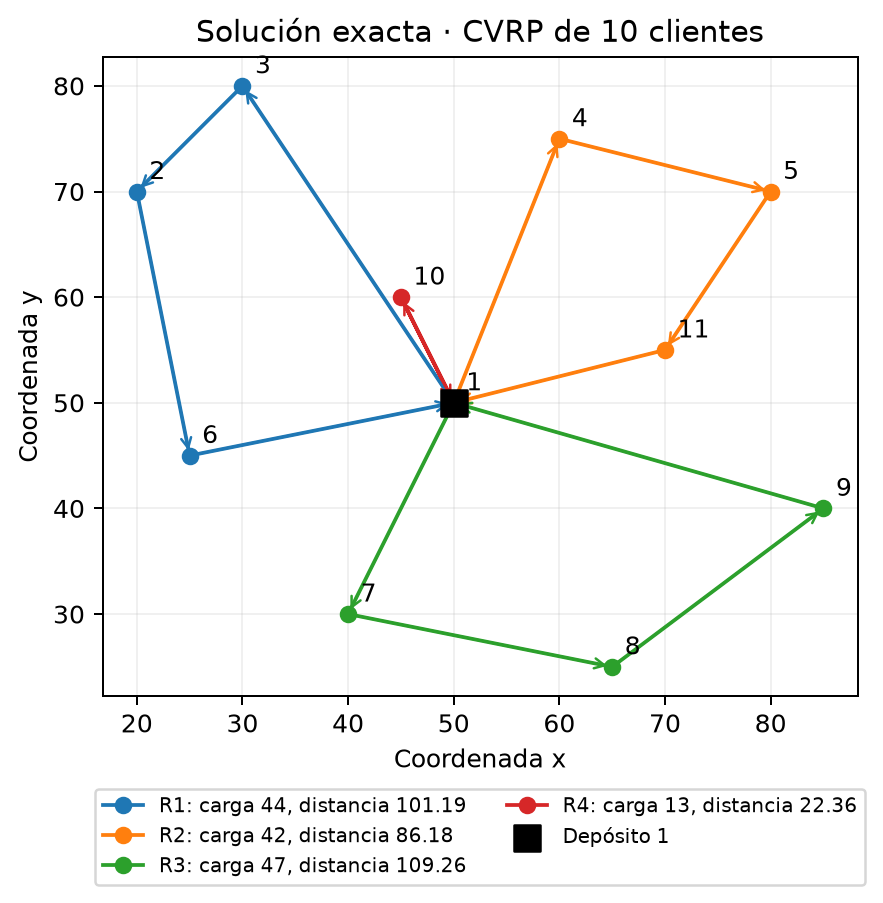
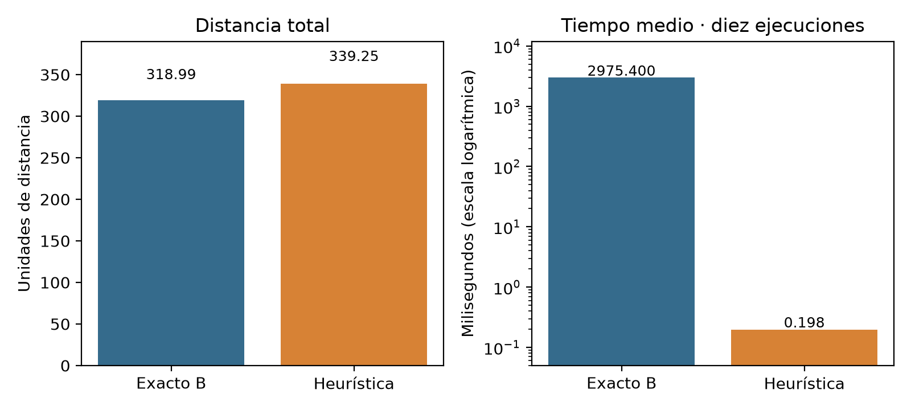

# CVRP de logística urbana: solución exacta frente a heurística

Ruteo de vehículos con capacidad limitada (**CVRP**) para una instancia didáctica de **10 clientes y un depósito**. El repositorio resuelve el caso con un **modelo exacto de arcos binarios y carga física** (PuLP + CBC), lo contrasta con la heurística de **ahorros de Clarke–Wright + 2-opt** y reúne datos, resultados, figuras, código de verificación y el informe vigente.

Proyecto del curso *Diseño de algoritmos matemáticos bioinspirados*, Etapa 1. Una sola instancia: los resultados ilustran el método, no demuestran superioridad general.



## Resultado en breve

Distancias (idénticas en todas las ejecuciones y con cualquier modelo) y tiempos de la **medición nueva con el modelo B** (`results/medicion_modelo_B_2026-10-15/`, 10 repeticiones tras calentamiento, un solo equipo):

| | Exacto, sin flota fija | Exacto, exactamente 3 rutas | Heurística (C–W + 2-opt) |
|---|---:|---:|---:|
| Distancia total (unidades) | **318.9895** | 339.1647 | 339.2529 |
| Rutas | 4 | 3 | 4 |
| Garantía | óptimo probado (10/10 corridas) | óptimo probado (10/10 corridas) | factible, sin garantía |
| Tiempo medio ± σ | 2.975 ± 0.097 s | 10.979 ± 0.641 s | 0.198 ± 0.080 ms |

**Porcentajes, cada uno con su denominador:**

- **GAP de costo** = 100 · (339.2529 − 318.9895) / **318.9895** ≈ **6.35 %**: cuánto más larga es la ruta de la heurística que la óptima. No es una cota del solver.
- Reducción de distancia del exacto respecto de la heurística = 100 · (339.2529 − 318.9895) / **339.2529** ≈ 5.97 %. Mismo ahorro de 20.263 unidades con otra base; no sustituye al GAP.
- Reducción de tiempo de la heurística = 100 · (t_E − t_H) / **t_E** ≈ 99.99 %; razón t_E / t_H ≈ 15 008. El tiempo es otra cantidad y no se mezcla con el GAP.
- Tres rutas en lugar de cuatro: 20.175 unidades más, 6.32 % sobre el óptimo libre. Minimizar distancia y minimizar vehículos son objetivos distintos.

> **Evidencia histórica, separada.** El informe vigente usa el modelo B y esta medición como principal. Las mediciones anteriores del modelo A (con 1 013 restricciones de subrutas: 10.970 s de media y 0.487 ms para la heurística) siguen en [`results/`](results/) como antecedente, junto con una reejecución propia del modelo A de 5.421 s y distancias idénticas ([`results/reproduccion_2026-10-15/`](results/reproduccion_2026-10-15/LEEME.md)). **Los tiempos no son comparables entre mediciones**: dependen del modelo, del equipo y del momento (véase [`docs/coherencia.md`](docs/coherencia.md)), ni con los del [modelo anterior](archive/v1_modelo_particion_rutas/README.md).

**Datos de la instancia:** capacidad por vehículo `Q = 50`; demanda total 146 → al menos `⌈146/50⌉ = 3` rutas. Distancia euclidiana **sin redondeo** (con distancias enteras tipo EUC_2D el óptimo es 317). El archivo no indica unidades físicas.

## El problema

Una flota homogénea sale de un depósito, entrega a cada cliente una sola vez sin superar la capacidad y regresa. Se minimiza la distancia recorrida; el número de rutas lo decide el modelo. Con tres rutas se puede atender a todos (carga libre global 2.7 %), pero recorren más que las cuatro rutas óptimas.

## Método exacto frente a heurística

| | Modelo exacto (B, predeterminado) | Clarke–Wright + 2-opt |
|---|---|---|
| Idea | Elige arcos `xᵢⱼ` y la carga que viaja por cada uno `fᵢⱼ`; CBC prueba el óptimo | Fusiona rutas por mayor ahorro `cᵢ₁ + cⱼ₁ − cᵢⱼ` y pule cada ruta con 2-opt |
| Restricciones | visita, continuidad, balance en depósito, balance de producto, capacidad por arco. Las subrutas aisladas ya las excluye el balance de producto mientras toda demanda sea positiva | capacidad al fusionar |
| Tamaño del modelo | 220 variables · 154 restricciones (el modelo A añade 1 013 subrutas: 1 167) | — |
| Escala | no basta para instancias grandes | rápida, sin garantía |

Hay tres variantes (`--modelo`): **B** (predeterminada), **A** (reproduce la evidencia histórica) y **C** (experimental, con cotas de carga más ajustadas). Su comparación está en [`results/comparacion_variantes_2026-10-15/`](results/comparacion_variantes_2026-10-15/LEEME.md): sin flota fija B resolvió en 2.07 s frente a 5.49 s de A, y con tres rutas B probó el óptimo en 10/10 corridas y A en 2/10 con un límite de 120 s; los tiempos absolutos de tres rutas muestran deriva del equipo.


Ecuaciones completas, por qué no hacen falta las subrutas, estados del solver y protocolo de medición: [`docs/metodologia.md`](docs/metodologia.md).

## Rutas

**Óptima (exacta), 318.9895:**

| Ruta | Clientes | Carga / 50 | Distancia |
|---|---|---:|---:|
| 1 | 1 → 3 → 2 → 6 → 1 | 44 | 101.19 |
| 2 | 1 → 4 → 5 → 11 → 1 | 42 | 86.18 |
| 3 | 1 → 7 → 8 → 9 → 1 | 47 | 109.26 |
| 4 | 1 → 10 → 1 | 13 | 22.36 |

**Heurística, 339.2529:** [`figures/rutas_heuristica.png`](figures/rutas_heuristica.png) (cargas 17, 44, 36 y 49).
**Flota mínima, 3 rutas, 339.1647:** [`figures/rutas_tres.png`](figures/rutas_tres.png) (cargas 47, 50 y 49), certificado por enumeración de particiones. El modelo B lo prueba en 10/10 corridas; el modelo A de la evidencia histórica no lo probó en 120 s ([detalle](docs/coherencia.md#2-contradicción-encontrada-escenario-de-tres-rutas)).



Las figuras del modelo A (comparación con 10 970 ms y diagrama con las restricciones de subrutas) se conservan, identificadas como históricas, en [`figures/historicas/`](figures/historicas/LEEME.md).

## Informe vigente y versiones históricas

| Documento | Estado |
|---|---|
| [`docs/Reto_CVRP_revisado.docx`](docs/Reto_CVRP_revisado.docx) | **Vigente** (revisión del 15 de octubre de 2026, modelo de arcos y carga). Copia de respaldo; la versión editable no se enlaza aquí. Usa el modelo B y su medición principal; conserva el modelo A como antecedente histórico y la comparación A/B/C. |
| [`archive/v1_modelo_particion_rutas/`](archive/v1_modelo_particion_rutas/) | Histórico: modelo anterior por partición de rutas, válido pero superado. |
| Versión LaTeX | Pendiente de actualización y aprobación; **no incluida**. |

## Reproducir

Requiere Python 3.12 (otras versiones 3.10+ deberían funcionar, no se probaron). CBC viene incluido con PuLP.

**Windows (PowerShell)** — comprobado en este repositorio:

```powershell
git clone <url-del-repositorio> cvrp-logistica-urbana
cd cvrp-logistica-urbana
python -m venv .venv
.\.venv\Scripts\Activate.ps1
python -m pip install -r requirements.txt

# 1. Comprobar la evidencia versionada (segundos)
python src\verificar_resultados.py results
python src\verificar_resultados.py results\medicion_modelo_B_2026-10-15

# 2. Volver a resolver y medir con el modelo B (unos minutos)
python src\resolver_cvrp_arcos.py data\instancia.txt --out results\local_B
python src\verificar_resultados.py results\local_B

# 3. Pruebas del manejo de estados del solver
python -m unittest discover -s tests -v
```

**macOS / Linux** — instrucciones **no ejecutadas aquí** (el trabajo se hizo solo en Windows 11); equivalen a las de arriba con las órdenes habituales de cada sistema:

```bash
git clone <url-del-repositorio> cvrp-logistica-urbana
cd cvrp-logistica-urbana
python3 -m venv .venv
source .venv/bin/activate
python -m pip install -r requirements.txt

python src/verificar_resultados.py results
python src/resolver_cvrp_arcos.py data/instancia.txt --out results/local_B
python src/verificar_resultados.py results/local_B
python -m unittest discover -s tests -v
```

Opciones de `resolver_cvrp_arcos.py`: `--modelo {A,B,C}` (B por defecto; `A` reproduce el modelo histórico), `--repeticiones N` (10), `--limite-libre S` y `--limite-tres-rutas S` (120 s). La comparación de variantes es `python src/comparar_variantes.py --out results/local_comparacion` (≈ 25 min por el modelo A con tres rutas). Use siempre una carpeta `--out` nueva: `results/` contiene evidencia citada que no debe sobrescribirse. Los tiempos cambiarán con el equipo. Si PowerShell bloquea la activación del entorno: `Set-ExecutionPolicy -Scope Process Bypass`.

Salidas de cada ejecución: `resultados.json`, `mediciones.csv`, `matriz_costos.csv` y un registro `cbc_<caso>_<n>.log` por corrida. Para generar las figuras: `python src/generar_figuras.py <carpeta de resultados> --salida figures_local`.

## Mapa de archivos

| Ruta | Contenido |
|---|---|
| [`src/resolver_cvrp_arcos.py`](src/resolver_cvrp_arcos.py) | Modelos A/B/C, estados del solver, heurística, certificación por particiones, mediciones |
| [`src/comparar_variantes.py`](src/comparar_variantes.py) | Comparación de A, B y C con orden rotado y calentamiento |
| [`src/verificar_resultados.py`](src/verificar_resultados.py) | Recalcula distancias, cargas, porcentajes y coherencia de un directorio de resultados |
| [`src/generar_figuras.py`](src/generar_figuras.py) | Regenera las figuras desde `resultados.json` |
| [`tests/test_estados.py`](tests/test_estados.py) | Estados del solver, demandas positivas, tamaño de los modelos, validez de las cotas |
| [`data/`](data/README.md) | Instancia `CVRP_10` y su descripción |
| [`results/`](results/) | Evidencia histórica del informe (modelo A): mediciones, matriz, JSON y registros CBC |
| [`results/reproduccion_2026-10-15/`](results/reproduccion_2026-10-15/LEEME.md) | Reejecución posterior del modelo A, con su entorno |
| [`results/medicion_modelo_B_2026-10-15/`](results/medicion_modelo_B_2026-10-15/LEEME.md) | Medición nueva con el modelo B |
| [`results/comparacion_variantes_2026-10-15/`](results/comparacion_variantes_2026-10-15/LEEME.md) | Comparación de A, B y C |
| [`figures/`](figures/) | Rutas, comparación y diagrama del modelo B; [`historicas/`](figures/historicas/LEEME.md): figuras del modelo A |
| [`docs/`](docs/) | Informe vigente, [metodología](docs/metodologia.md), [coherencia](docs/coherencia.md), [inventario](docs/inventario.md) |
| [`archive/`](archive/README.md) | Modelo anterior y script original de la revisión |
| [`ATRIBUCIONES.md`](ATRIBUCIONES.md) | Material de terceros y licencias |

Las fuentes de las tablas y figuras están en [`docs/inventario.md`](docs/inventario.md). Las mediciones principales del informe (Tabla 8, Tabla 9 y Figura 5) salen de `results/medicion_modelo_B_2026-10-15/mediciones.csv` (la Tabla 8 se contrastó con esa tabla) y la comparación A/B/C de `results/comparacion_variantes_2026-10-15/`. La evidencia del modelo A sigue en `results/`; su campo histórico `tres_rutas` contiene un incumbente de 361.0004 y no es fuente del óptimo de tres rutas (339.1647, certificado por particiones).

## Estado de la verificación

**Comprobado** (ejecutado el 15 de octubre de 2026): `src/verificar_resultados.py` sobre `results/` (26 comprobaciones), `results/reproduccion_2026-10-15` (27), `results/medicion_modelo_B_2026-10-15` (38, sin avisos) y `results/comparacion_variantes_2026-10-15` (13, con 8 avisos: corridas del modelo A detenidas sin probar optimalidad); y las pruebas de `tests/`. Cada solución atiende a cada cliente una vez, respeta `Q = 50`, tiene distancias recomputadas desde la instancia y coincide con la certificación independiente por programación dinámica (318.9895 con cuatro rutas, 339.1647 con tres).

**Hallazgo corregido:** el registro histórico del modelo de arcos con tres rutas terminó por tiempo en 361.0004 sin probar optimalidad. El informe y su copia DOCX ya atribuyen 339.1647 a la certificación por particiones. [Análisis completo](docs/coherencia.md).

**Pendiente o no verificado:**
- Los tiempos en otro equipo, y la causa de la diferencia entre 10.97 s y 5.42 s en el modelo A (se observó variación de rendimiento del equipo entre corridas, que no prueba la causa).
- Las instrucciones para macOS/Linux no se han ejecutado.
- No se ejecutó de nuevo el código del modelo anterior (`archive/`).
- Qué algoritmo acordó el equipo como «el algoritmo desarrollado con anterioridad». Se conserva Clarke–Wright + 2-opt; el enunciado pide programarlo y comparar tiempo y costo en porcentaje, sin exigir una metaheurística.
- No hay integración continua ni insignias de pruebas.

## Limitaciones

Una instancia pequeña y didáctica; sin unidades físicas, costos monetarios ni emisiones; el programa solo admite demandas de clientes estrictamente positivas (`leer()` rechaza las demás) y el modelo B depende de ello; ninguna formulación está pensada para instancias grandes; la razón de tiempos depende de la formulación, de CBC y del equipo.

## Fuentes

Clarke y Wright (1964), *Operations Research* 12(4); Gillett y Miller (1974); Prins (2004); Vidal (2022); Reinelt, TSPLIB; y las demás referencias del [informe](docs/Reto_CVRP_revisado.docx). Instancia y licencias: [`ATRIBUCIONES.md`](ATRIBUCIONES.md). Este repositorio **no declara licencia general**.
