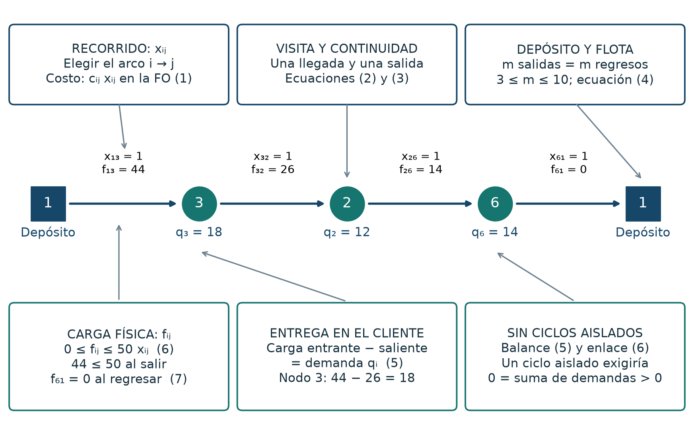

# Metodología

Este documento resume el modelo, los métodos y los supuestos de **el código de este repositorio**. El análisis completo, con la discusión del problema y la bibliografía, está en el [informe vigente](Reto_CVRP_revisado.docx), que usa el modelo B y su medición principal; las mediciones históricas del modelo A se conservan aparte (véase la sección 7 y [`coherencia.md`](coherencia.md)).

## 1. Problema

CVRP estático, determinista, simétrico y con flota homogénea: un depósito (nodo 1), 10 clientes con demanda conocida, vehículos de capacidad `Q = 50`. Cada cliente se atiende una sola vez, sin entregas divididas ni recargas intermedias, y cada ruta parte y termina en el depósito. El archivo de la instancia no fija el tamaño de la flota, horarios ni costos monetarios; por eso el caso principal **minimiza solo la distancia** y deja que el modelo decida cuántas rutas usar. El escenario de **exactamente tres rutas** (la flota mínima, `⌈146/50⌉ = 3`) se resuelve aparte.

## 2. Modelo exacto: arcos binarios y carga física

(El diagrama del modelo A, con las restricciones de subrutas, está en [`../figures/historicas/`](../figures/historicas/LEEME.md).)

Conjuntos: $V = \{1,\dots,11\}$, clientes $C = V \setminus \{1\}$, arcos $A = \{(i,j) : i \ne j\}$ (110 arcos).
Variables: $x_{ij} \in \{0,1\}$ (se recorre el arco $i \to j$) y $f_{ij} \ge 0$ (producto que el vehículo aún lleva al recorrer ese arco).

$$\min \sum_{(i,j)\in A} c_{ij}\,x_{ij} \tag{1}$$

| Ec. | Restricción | Significado |
|---|---|---|
| (2) | $\sum_{j} x_{ji} = 1,\ \forall i \in C$ | cada cliente recibe una visita |
| (3) | $\sum_{j} x_{ij} = \sum_{j} x_{ji},\ \forall i \in C$ | continuidad: lo que entra, sale |
| (4) | $\sum_{j\in C} x_{1j} = \sum_{i\in C} x_{i1} = m,\quad \lceil 146/50\rceil \le m \le 10$ | balance de rutas en el depósito |
| (5) | $\sum_{j} f_{ji} - \sum_{j} f_{ij} = q_i,\ \forall i \in C$ | balance de producto: se entrega la demanda $q_i$ |
| (6) | $0 \le f_{ij} \le Q\,x_{ij}$ | capacidad y carga solo en arcos usados |
| (7) | $f_{i1} = 0,\ \forall i \in C$ | regreso vacío; con $\sum_j f_{1j} = 146$ |
| (8) | $\sum_{i,j\in S,\,i\ne j} x_{ij} \le \lvert S\rvert-1,\ \forall S\subseteq C,\ \lvert S\rvert\ge 2$ | eliminación de subrutas (solo en el modelo A) |

### Variantes disponibles (`--modelo`)

| Modelo | Contenido | Restricciones (libre) | Uso |
|---|---|---:|---|
| **B** (predeterminado) | (1)–(7), sin (8) | 154 | modelo de trabajo |
| **A** | (1)–(8), con las $2^{10}-10-1 = 1\,013$ subrutas enumeradas | 1 167 | reproduce la evidencia histórica del informe |
| **C** (experimental) | como B, con $q_j x_{ij} \le f_{ij} \le (Q-q_i)\,x_{ij}$ en lugar de (6) | 264 | opcional, solo para comparar |

Con exactamente tres rutas se añade $m = 3$ (una restricción más). Todas se resuelven con CBC (incluido en PuLP), `gapRel = 0`, `gapAbs = 0`.

### Por qué B no necesita (8)

Por (2) y (3) cada cliente tiene exactamente un arco de entrada y uno de salida, así que los arcos elegidos forman rutas que pasan por el depósito y, quizá, ciclos de clientes sin depósito. Sea $S \subseteq C$ el conjunto de clientes de uno de esos ciclos aislados: ningún arco elegido une $S$ con el resto, de modo que por (6) $f = 0$ en todos los arcos entre $S$ y el resto. Al sumar el balance (5) sobre $S$, el flujo de cada arco interno aparece una vez sumando y otra restando y se cancela: queda $0 = \sum_{i \in S} q_i$. Con **demandas de clientes estrictamente positivas** esa suma es mayor que cero y la solución es imposible. Por tanto (5) ya prohíbe los ciclos aislados y (8) es redundante para la **factibilidad entera**.

La demostración depende de $q_i > 0$: con una demanda nula, un ciclo aislado de clientes sin demanda cumpliría (5) con $0 = 0$. **Alcance real del programa:** `leer()` rechaza cualquier cliente con demanda no positiva (exige $0 < q_i \le Q$), de modo que el programa solo admite instancias con demandas estrictamente positivas y B es válido en todas ellas. Además, `construir_modelo` —que se puede llamar directamente— lanza `ValueError` para los modelos B y C si recibe una demanda no positiva; con el modelo A esa llamada sí construiría el modelo, pero ese caso no se ofrece desde la línea de órdenes ni se probó con un solver. No se amplía el alcance a demandas nulas. Está cubierto en `tests/test_estados.py`.

Que (8) sea redundante para la factibilidad **no** significa que sea inútil ni inofensiva para el solver: en la relajación lineal sube la cota de 276.46 (modelo B) a 286.92 (modelo A), pero añade 1 013 filas y, en las mediciones de este repositorio, CBC resolvió más rápido sin ellas (véase [`coherencia.md`](coherencia.md)). Eso es un resultado de esta instancia, formulación y versión de CBC, no una propiedad general.

### Igualdades que ya se deducen

- $\sum_j f_{1j} = 146$ se deduce de (5) y (7): al sumar (5) sobre todos los clientes los flujos internos se cancelan, queda $\sum_j f_{1j} - \sum_i f_{i1} = 146$ y (7) fija $f_{i1} = 0$.
- $m \le 10$ se deduce de (2): hay diez clientes y cada uno recibe un solo arco, de modo que a lo sumo diez arcos salen del depósito.

Ambas se mantienen en el código como comprobación legible, **no** como cortes que fortalezcan la relajación: ya están implicadas por el resto del modelo, también en la relajación lineal. La cota $m \ge 3$ es distinta: para enteros también se deduce (las relajaciones dan $m \ge 146/50 = 2.92$ y $m$ es entero), pero en la relajación lineal sí recorta $2.92 \le m < 3$, así que es una desigualdad válida que endurece levemente la relajación; por eso se conserva.

Escala: ni A (enumeración exponencial) ni B están pensados para instancias grandes; ahí haría falta separar desigualdades dinámicamente, usar un solver con cortes de capacidad o una formulación distinta.

## 3. Heurística: ahorros de Clarke–Wright + 2-opt

1. Cada cliente empieza en su propia ruta.
2. Se calculan los ahorros $s_{ij} = c_{1i} + c_{1j} - c_{ij}$ y se fusionan rutas en orden decreciente de ahorro si $i$ y $j$ son extremos de rutas distintas y la carga combinada no supera `Q`.
3. Cada ruta resultante se mejora con 2-opt.

Es determinista y factible por construcción, pero **no** garantiza optimalidad. Clarke–Wright + 2-opt es el algoritmo adoptado para esta entrega: su desarrollo se presenta en la sección 5 del informe, se implementa en el Anexo A y en `src/resolver_cvrp_arcos.py`, y se evalúa en la sección 7. Es una heurística clásica; no se presenta como algoritmo bioinspirado ni se atribuye su enseñanza a una clase previa.

## 4. Verificación independiente del óptimo

`certificar_dp` y `particion_optima` (en [`src/resolver_cvrp_arcos.py`](../src/resolver_cvrp_arcos.py)) enumeran todos los subconjuntos de clientes que caben en un vehículo, hallan la mejor ruta de cada uno por fuerza bruta y combinan una partición óptima por programación dinámica. No comparten código con el modelo de CBC, de modo que coincidir en 318.9894867 (cuatro rutas) y 339.1646738 (tres rutas) es una comprobación cruzada real. Se ejecuta fuera de todo cronómetro.

## 5. Estados del solver

PuLP informa `LpStatus = 'Optimal'` también cuando CBC se detiene por límite de tiempo con una solución entera, así que `LpStatus` **no** certifica optimalidad. `exacto()` clasifica cada corrida con `clasificar_estado(status, sol_status)`:

| Estado | Significado | ¿Hay rutas? |
|---|---|---|
| `optimo_probado` | `LpStatus` óptimo y `sol_status` óptimo | sí |
| `factible_sin_prueba` | solución entera al terminar el límite, sin probar optimalidad | sí (incumbente) |
| `sin_solucion_factible` | modelo infactible, o sin solución entera al terminar el límite | no |
| `fallo_solver` | excepción de PuLP/CBC, estado inesperado, o valores ausentes o fraccionarios en `x` | no |

Las rutas solo se reconstruyen de valores de `x` que sean 0 o 1 dentro de una tolerancia de $10^{-6}$; no se redondean valores fraccionarios. Con `exigir_optimo=True` cualquier estado distinto de `optimo_probado` lanza `ResultadoNoOptimo`. Las pruebas están en [`tests/test_estados.py`](../tests/test_estados.py).

## 6. Métricas y porcentajes

Cada porcentaje se calcula con un denominador explícito y no se sustituyen entre sí:

| Cantidad | Fórmula | Valor (datos del informe: $Z^*=318.989487$, $Z_{\text{heur}}=339.252870$) |
|---|---|---|
| **GAP de costo** | $100\,(Z_{\text{heur}}-Z^{*})/Z^{*}$ | 6.352 % |
| Reducción de distancia del exacto respecto de la heurística | $100\,(Z_{\text{heur}}-Z^{*})/Z_{\text{heur}}$ | 5.973 % |
| Reducción de tiempo de la heurística | $100\,(t_{E}-t_{H})/t_{E}$ | depende de la medición |
| Razón de tiempos | $t_E/t_H$ | depende de la medición |

El GAP de costo **no** es una cota ni una brecha de optimalidad del solver, y la diferencia temporal es otra cantidad que no se mezcla con él. Las brechas de CBC (`brecha_cbc`, `cota_inferior`) solo existen cuando una corrida se detiene sin probar optimalidad.

## 7. Protocolo de medición

Medición principal, en `results/medicion_modelo_B_<fecha>/` (modelo B), sin tocar los registros históricos del modelo A:

- Calentamiento descartado (un caso libre, uno de tres rutas y la heurística) y diez repeticiones medidas por caso, más diez de la heurística junto al caso libre.
- Tiempos separados `build_s` (construir el modelo), `solve_s` (CBC) y `reconstruct_s` (rutas); `total_s` es su suma y es el mismo tramo que cronometraba el script histórico. Lectura del archivo, matriz, verificación, certificación independiente y figuras quedan fuera.
- Cada fila registra el entorno y la configuración (límites, `threads`, `gapRel`, `gapAbs`), el estado del solver, objetivo, cota inferior y brecha de CBC, nodos e iteraciones.
- Para el escenario de tres rutas el promedio del tiempo se llama **tiempo de ejecución**; solo sería «tiempo hasta el óptimo» si todas las corridas probaron optimalidad (la columna `optimo_probado` de `resultados.json` indica cuántas).
- Comparación entre modelos: `src/comparar_variantes.py` alterna el orden de A, B y C en cada repetición y hace un calentamiento por variante.
- Ambos métodos son deterministas: las repeticiones miden variación temporal, no diversidad de soluciones. Los nodos e iteraciones de CBC también se repiten exactamente; solo cambia el reloj.
- Los tiempos dependen del equipo, la carga del sistema y la versión de CBC. No son comparables con los del modelo anterior por partición de rutas, ni con las mediciones históricas del modelo A hechas en otro momento.

Las mediciones históricas del modelo A (10.970 s) siguen en `results/` y no se sustituyeron; el informe vigente usa la medición del modelo B como principal.

## 8. Supuestos y limitaciones

- Una sola instancia didáctica de 10 clientes: los resultados no prueban superioridad general de ningún método.
- Sin unidades físicas, costos monetarios ni emisiones: el objetivo es distancia, no dinero ni CO₂.
- El modelo usa arcos dirigidos aunque la matriz es simétrica: cada ruta puede aparecer en dos sentidos equivalentes; las figuras muestran una orientación representativa.
- La razón de tiempos exacto/heurística depende de la formulación, de CBC y del equipo, y no generaliza a otras formulaciones exactas.
- Los tiempos documentados provienen de una sola máquina (véase `entorno` en cada `resultados.json`).

## 9. Fuentes

La bibliografía completa (Clarke y Wright 1964, Gillett y Miller 1974, Prins 2004, Vidal 2022, Reinelt/TSPLIB y otras) está en la sección *Referencias* del [informe vigente](Reto_CVRP_revisado.docx). Atribuciones de material de terceros: [`../ATRIBUCIONES.md`](../ATRIBUCIONES.md).
